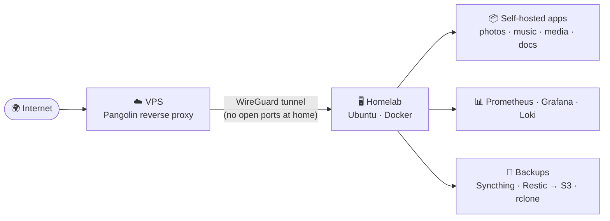

### 👋 Hi, I'm Jaume

**Developer & DevOps engineer** who likes automating things, both at work and at home.
In my spare time I run a **self-hosted homelab**: a recycled laptop running dozens of services I use every day, reachable from anywhere through my own reverse proxy and backed up 3-2-1.

🛠️ **Toolkit:** Docker · Kubernetes · Jenkins · Terraform · GitHub Actions · Linux · Prometheus/Grafana · TypeScript · Angular · React · NestJS · Fastify · MongoDB · PostgreSQL

---

### 🏠 Homelab

<!-- HOMELAB:START -->
- 📦 **58** services running as Docker Compose stacks
- 🧪 **62** more tried and retired (configs kept)
- 🚀 **4** services built by me
<!-- HOMELAB:END -->

📖 **Full write-up: [jaumoso.github.io/portfolio](https://jaumoso.github.io/portfolio/)**: architecture, network, backups, monitoring, lessons learned, timeline and roadmap.
🗂️ Compose files: [Jaumoso/homelab](https://github.com/Jaumoso/homelab) (pushed automatically every week)

---

### 🚀 Featured projects

| Project | What it is | Stack |
| --- | --- | --- |
| **[Kalenda](https://github.com/Jaumoso/kalenda)** | Self-hosted web app to design and print personalised photo calendars | React · Fastify · Prisma · PostgreSQL · Playwright · Docker |
| **[docker-picard](https://github.com/Jaumoso/docker-picard)** | MusicBrainz Picard in Docker, used from the browser against the music library on my server | Docker · noVNC · GitHub Actions → GHCR |
| **[photo-watcher](https://github.com/Jaumoso/photo-watcher)** | Watches incoming folders and files photos and videos by capture date into the archive | Python · watchdog · Docker |

### 🔭 Currently working on

- Kalenda: user guide and production hardening
- Rewriting my homelab rebuild automation (Ansible), so the server can be rebuilt from scratch → [roadmap](https://jaumoso.github.io/portfolio/roadmap/)

<samp><a href="./metrics.md">GitHub metrics</a> · <a href="https://jaumoso.github.io/portfolio/">Portfolio</a></samp>

